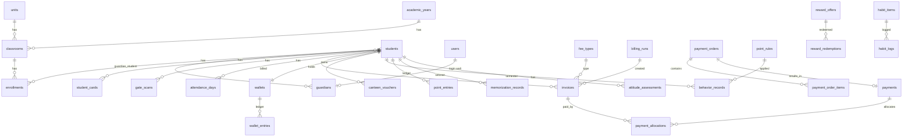

# SCHEMA — Rancangan Database

Status: **rancangan Fase 0**. Tabel dibuat bertahap oleh tugas di `TODO.md` (kolom "Dibuat di"). Setiap migration baru wajib memperbarui dokumen ini di commit yang sama.

Konvensi:

- Nama tabel & kolom Bahasa Inggris, `snake_case`, jamak untuk tabel.
- PK `id` (bigint). FK `<tabel_tunggal>_id` dengan `constrained()`; default `restrictOnDelete()` (data keuangan/poin tidak boleh ikut terhapus).
- **Uang** disimpan sebagai `unsignedBigInteger`/`bigInteger` dalam **rupiah utuh** (tanpa desimal). Tidak pernah `float`/`decimal` untuk rupiah.
- Waktu disimpan UTC (`timestamp`), ditampilkan WITA. Tanggal bisnis (hari sekolah) memakai kolom `date` yang dihitung dalam WITA.
- Enum disimpan sebagai `string(32)` + PHP backed enum (bukan enum DB), agar portabel SQLite/MySQL.
- Tabel ledger (`*_entries`) **append-only**: tidak ada `updated_at`, tidak ada update/delete dari aplikasi.
- Soft delete hanya untuk data induk (`students`, `guardians`, `users`). Data transaksi tidak pernah dihapus.

## Peta relasi (ringkas)

---

## A. Inti dan data induk (Fase 1–2)

### `users` (starter kit, diubah T-102)

Tambah: `username string(50) unique nullable`, `phone string(20) unique nullable`, `is_active bool default true`, `last_login_at timestamp null`, `deleted_at`.
`email` menjadi nullable (wali sering tidak punya email). Login dengan username/phone/NIS (lihat T-103).

### `roles`, `permissions`, `model_has_roles`, ... (spatie, sudah dipublish ✅)

### `settings` (T-201 ✅)

`key string(100) unique`, `value json null`, `updated_by → users null` (null on delete), timestamps. Diakses hanya lewat `App\Services\Settings\SettingsRepository`: semua kunci dibaca sekaligus dan di-cache (`settings.values`), cache dibuang setelah commit, perubahan diaudit (`settings_updated`, hanya kunci yang berubah).
Kunci yang diizinkan = enum `App\Enums\SettingKey` (kunci lain ditolak): `identity.app_name`, `identity.foundation_name`, `identity.address`, `identity.phone` (dinormalisasi `08…`), `identity.email`, `identity.logo_path`, `identity.favicon_path` (jalur di disk privat `local`, folder `branding/`), `appearance.primary_color` (hex `#RRGGBB` tervalidasi kontras WCAG AA). Tanpa baris → nilai bawaan dari `config('app.name')` / `config('sekolah.foundation_name')`.

### `audit_logs` (T-105)

`user_id → users null`, `action string(32)` (`created|updated|deleted|reversed|login_failed|...`), `subject_type string`, `subject_id bigint null`,
`before json null`, `after json null`, `ip string(45) null`, `user_agent string(255) null`, `created_at`. Indeks: (`subject_type`,`subject_id`), (`user_id`,`created_at`).

### `units` (T-202 ✅)

`code string(10) unique` (MI/RA/TPQ, huruf besar + angka), `name string(100)`, `head_user_id → users null` (null on delete; diisi di T-209), `attendance_settings json`, `is_active bool default true`, timestamps.
`attendance_settings` = `{check_in_opens_at, late_after, absent_after, check_out_opens_at}` format `H:i` WITA (`App\Support\AttendanceHours`); urutan wajib masuk < terlambat < alpa dan pulang > terlambat. Unit tidak dihapus, hanya dinonaktifkan. `UnitSeeder` (dipanggil `ProductionSeeder`) membuat MI/RA/TPQ dengan jam bawaan `config('sekolah.attendance.defaults')` tanpa menimpa unit yang sudah ada.

### `academic_years` (T-203 ✅)

`name string(9)` (2026/2027, dua tahun berurutan), `semester string(6)` (`ganjil|genap`, enum `App\Enums\Semester`), `starts_on date`, `ends_on date` (> `starts_on`), `is_active bool default false`, timestamps. Unik (`name`,`semester`), indeks `is_active`.
Maks satu aktif dijaga `AcademicYearService::activate` (lock baris + transaksi) + tes. Tahun ajaran aktif atau yang sudah dipakai rombel tidak dapat dihapus (`AcademicYearGuardException`; FK `classrooms.academic_year_id` juga restrict).

### `school_calendar_days` (T-505)

`unit_id → units null` (null = semua unit), `date`, `type string` (`holiday|event`), `title`. Unik (`unit_id`,`date`).

### `classrooms` (rombel, T-204 ✅)

`unit_id → units` (restrict on delete), `academic_year_id → academic_years` (restrict on delete), `grade string(10)` (1–6, A/B, jilid; teks bebas), `name string(30)` (1-A), `homeroom_teacher_id → users null` (null on delete), `is_active bool default true`, timestamps. Unik (`academic_year_id`,`unit_id`,`name`).
Ditulis hanya lewat `App\Services\Classrooms\ClassroomService` (audit `created|updated|activated|deactivated|copied`). Wali kelas wajib pengguna aktif berperan `guru` (`ClassroomService::homeroomCandidates()`). Rombel tidak dihapus, hanya dinonaktifkan; unit & tahun ajaran rombel tidak bisa dipindah lewat ubah.
"Salin dari tahun lain" (`copyFromYear`): menyalin rombel **aktif** satu unit dari tahun ajaran sumber ke tujuan, melewati nama yang sudah ada (tanpa beda huruf besar/kecil), wali kelas ikut hanya bila masih guru aktif; satu entri audit `copied` berisi jumlah disalin/dilewati.

### `students` (T-205 ✅)

`unit_id`, `nis string(20) unique`, `nisn string(20) unique nullable`, `name`, `nickname string(30) null` (dipakai di notifikasi), `gender string(1)`,
`birth_place null`, `birth_date null`, `address text null`, `photo_path null`, `status string` (`active|graduated|moved|inactive`), timestamps, `deleted_at`.
Indeks: (`unit_id`,`status`), (`name`). FK `unit_id` → `units` restrict. `gender` = `L|P` (enum `Gender`), `status` = enum `StudentStatus`. Foto: JPEG ≤ 300 KB, sisi terpanjang 600 px, di disk privat `local` `students/photos/<acak>.jpg`, disajikan lewat rute berizin `admin.students.photo`. Siswa tidak dihapus dari UI (status nonaktif); NIS/NISN unik termasuk baris terhapus lunak.

### `enrollments` (T-205 ✅)

`student_id`, `classroom_id`, `academic_year_id`, timestamps. Unik (`student_id`,`academic_year_id`); indeks (`classroom_id`,`academic_year_id`). Semua FK restrict. Rombel aktif siswa = enrollment tahun ajaran aktif. Pindah rombel di tahun yang sama memperbarui baris itu dengan audit `enrollment_moved` (sebelum/sesudah rombel); baris tahun lain tidak disentuh (riwayat).

### `student_mutations` (T-212 ✅) — append-only

`student_id → students` (restrict on delete), `type string(20)` (`in|out|graduated`, enum `App\Enums\MutationType`), `mutated_on date`, `school_name string(120) null`, `reason string(255)`, `recorded_by → users` (restrict on delete), `created_at`. Indeks: (`student_id`,`mutated_on`), (`type`,`mutated_on`). Ditulis hanya lewat `StudentMutationService` / `StudentPromotionService`.

### `guardians` (T-206 ✅)

`user_id → users unique` (restrict), `name`, `phone string(20)`, `relation string(10)` default `wali` (`ayah|ibu|wali`, enum `GuardianRelation`), `address text null`, timestamps, `deleted_at`. Indeks (`name`).
Akun login: `users.username` = `users.phone` = `guardians.phone` (nomor HP ternormalisasi `PhoneNumber::normalize`), peran `wali`, kata sandi awal acak (`InitialPassword`) hanya di-hash; tampil sekali lewat flash `credentials` dan dicetak sebagai "surat akun wali" dari browser. Tanpa paksa ganti kata sandi (ADR-015).
Ditulis hanya lewat `App\Services\Guardians\GuardianService` (audit `created|updated|children_linked|activated|deactivated|password_reset`; tanpa alamat dan kata sandi). Nomor HP milik akun yang sudah wali → anak ditautkan ke wali itu; milik akun staf → akun itu diberi peran `wali` dan tetap memakai kata sandinya (reset/nonaktif akun bersama hanya lewat Pengguna staf). Wali tidak dihapus: akun dinonaktifkan (`users.is_active`).

### `guardian_student` (T-206 ✅)

`id`, `guardian_id` (restrict), `student_id` (restrict), `relation string(10)`, `is_primary bool`. Unik (`guardian_id`,`student_id`); indeks (`student_id`,`is_primary`). Tepat satu wali utama per siswa dijaga `GuardianService` dalam transaksi (baris siswa terkait dikunci): menandai utama mencabut tanda wali lain; siswa yang kehilangan wali utama mendapat wali tertua lain yang tersisa. `relation` = hubungan wali saat ditautkan. Login NIS memetakan ke wali utama (FortifyServiceProvider).

### `staff_profiles` (T-209 ✅)

`user_id → users unique` (restrict), `unit_id → units null` (null on delete), `nip string(30) null`, `position string(80) null`, timestamps. Penugasan wali kelas lewat `classrooms.homeroom_teacher_id`. Ditulis lewat `StaffUserService`.

## B. Notifikasi (Fase 4)

### `notifications` (bawaan Laravel, T-402 ✅)

`id uuid primary`, `type`, `notifiable` (morphs ke `users`), `data text`, `read_at timestamp null`, timestamps. Indeks: (`notifiable_type`,`notifiable_id`,`read_at`).

### `push_subscriptions` (dari paket webpush, T-401 ✅)

Dipublish dari `laravel-notification-channels/webpush`; relasi polimorfik `subscribable` ke `users` (`HasPushSubscriptions`). Endpoint 404/410 dihapus otomatis oleh `WebPushChannel`.

### `notification_preferences` (T-403 ✅)

`user_id → users` (restrict), `category string(20)`, `enabled bool default true`, timestamps. Unik (`user_id`,`category`). Tidak ada baris = aktif. Kategori `billing` & `account` selalu aktif (`NotificationPreferenceService`).

## C. Presensi (Fase 5)

### `student_cards` (T-501)

`student_id`, `token_hash string(64) unique`, `issued_at`, `revoked_at null`, `issued_by → users`. Paling banyak satu kartu aktif per siswa (dijaga Service).

### `gate_scans` (T-502) — append-only

`student_id`, `scanned_at timestamp`, `school_date date`, `direction string` (`in|out`), `result string` (`on_time|late|check_out|duplicate|outside_hours`), `device_label string(50) null`, `scanned_by → users`, `created_at`.
Indeks: (`school_date`,`student_id`), (`scanned_at`).

### `attendance_days` (T-502)

`student_id`, `school_date date`, `status string` (`present|late|excused|sick|absent`), `checked_in_at null`, `checked_out_at null`, `leave_request_id null`, `decided_by string` (`scan|leave|system|manual`), timestamps.
Unik (`student_id`,`school_date`). Indeks (`school_date`,`status`).

### `leave_requests` (T-506)

`student_id`, `requested_by → users`, `type string` (`sick|excused`), `starts_on date`, `ends_on date`, `reason text`, `attachment_path null`, `status string` (`pending|approved|rejected`), `decided_by null`, `decided_at null`, `decision_note null`, timestamps.

## D. Keuangan sekolah (Fase 6)

_Syarat ujian (ADR-016): lihat `exam_periods`, `exam_period_requirements`, `exam_eligibility_overrides` di akhir bagian D._

### `fee_types` (T-601)

`unit_id null`, `name`, `category string(30)` (SPP, Uang Pangkal, Kegiatan, ...), `recurrence string` (`monthly|once`), `default_amount bigint`, `is_active`, timestamps.

### `billing_runs` (T-602)

`fee_type_id`, `target_type string` (`unit|grade|classroom|students`), `target_payload json` (id terpilih), `period_from date null`, `period_to date null`, `due_day tinyint null` / `due_date date null`,
`amount bigint`, `created_by`, `invoice_count int`, `total_amount bigint`, `created_at`.

### `invoices` (T-602)

`student_id`, `fee_type_id`, `billing_run_id null`, `period date null` (tanggal 1 bulan tagihan; null untuk `once`), `description`, `amount bigint` (nominal awal), `adjustment_total bigint default 0`,
`paid_total bigint default 0`, `due_date date`, `status string` (`unpaid|partial|paid|cancelled`), `cancelled_reason null`, timestamps.
**Unik (`student_id`,`fee_type_id`,`period`)** — mencegah tagihan ganda (untuk `once`, `period` = tanggal terbit dinormalisasi ke tahun ajaran; lihat T-602).
Indeks (`status`,`due_date`), (`student_id`,`status`). Sisa = `amount - adjustment_total - paid_total` (dihitung, tidak disimpan).

### `invoice_adjustments` (T-604) — append-only

`invoice_id`, `type string` (`discount|waiver|correction`), `amount bigint` (positif mengurangi tagihan), `reason`, `created_by`, `created_at`.

### `payments` (T-605)

`student_id`, `method string` (`cash|transfer|midtrans`), `amount bigint`, `paid_at`, `received_by → users null`, `payment_order_id null unique`, `reference string null`,
`receipt_number string unique`, `reversed_at null`, `reversal_reason null`, `reversed_by null`, `created_at`.

### `payment_allocations` (T-605)

`payment_id`, `invoice_id`, `amount bigint`. Unik (`payment_id`,`invoice_id`).

### `exam_periods` (T-611, ADR-016)

`unit_id`, `name`, `delivery string` (`cbt|paper`), `starts_on date`, `ends_on date`, `status string` (`draft|active|closed`), `created_by → users`, timestamps.

### `exam_period_requirements` (T-611)

`exam_period_id`, `fee_type_id`, `period_until date null` (untuk tagihan bulanan: wajib lunas s.d. bulan ini), `invoice_scope string` (`up_to_period|all_open`). Kelayakan **tidak disimpan**; dihitung `ExamEligibilityResolver` dari `invoices` + overrides.

### `exam_eligibility_overrides` (T-612)

`exam_period_id`, `student_id`, `reason text`, `granted_by → users` (hanya admin), `granted_at`, `revoked_by null`, `revoked_at null`. Unik aktif per (`exam_period_id`,`student_id`). Diaudit.

## E. Pembayaran online (Fase 7)

### `payment_orders` (T-702)

`order_id string(50) unique` (format `INV-<ulid>` / `TOP-<ulid>`), `purpose string` (`invoices|wallet_topup`), `student_id`, `guardian_id`, `gross_amount bigint`,
`status string` (`pending|paid|expired|failed|cancelled`), `snap_token null`, `snap_redirect_url null`, `expires_at`, `paid_at null`, `midtrans_transaction_id null`,
`payment_type string null`, `last_status_payload json null`, timestamps. Indeks (`status`,`expires_at`).

### `payment_order_items` (T-702)

`payment_order_id`, `invoice_id null`, `description`, `amount bigint`.

### `payment_notifications` (T-703) — append-only, log mentah

`order_id`, `transaction_status`, `status_code`, `signature_valid bool`, `payload json`, `processed_at null`, `process_result string null`, `received_at`.

## F. Dompet kantin (Fase 8)

### `wallets` (T-801)

`student_id unique`, `balance bigint default 0` (cache ledger), `daily_limit bigint`, `is_frozen bool default false`, timestamps.

### `wallet_entries` (T-801) — append-only

`wallet_id`, `type string` (`topup|purchase|reversal|adjustment`), `amount bigint` (bertanda), `balance_after bigint`, `idempotency_key string(80) unique`,
`reference_type null`, `reference_id null`, `description string null`, `created_by → users null`, `created_at`. Indeks (`wallet_id`,`created_at`).

### `canteen_transactions` (T-803)

`student_id`, `cashier_id → users`, `client_uuid uuid unique` (dari POS), `total bigint`, `paid_from_vouchers bigint`, `paid_from_wallet bigint`, `items json null`,
`status string` (`completed|reversed`), `reversed_at null`, `reversed_by null`, `reversal_reason null`, `created_at`.

### `canteen_vouchers` (T-904 ✅)

`student_id` (`→ students`, restrict), `reward_redemption_id unique` (`→ reward_redemptions`, restrict), `amount bigint`, `remaining bigint`, `expires_on date`, `created_at`. Indeks (`student_id`, `expires_on`). Ditulis lewat `RewardRedemptionService`.

### `voucher_redemptions` (T-904) — append-only

`canteen_voucher_id`, `canteen_transaction_id`, `amount bigint` (positif pakai, negatif pengembalian saat reversal), `created_at`.

## G. Buku Saku BK dan reward (Fase 9)

### `point_rules` (T-901 ✅)

`unit_id null` (`→ units`, restrict), `code string(30)`, `name string(180)`, `category string(20)` (`violation|achievement|good_deed`), `level string(50) null` (untuk prestasi: sekolah/kecamatan/kabupaten/...), `points smallint unsigned`, `is_active`, timestamps. Unik (`unit_id`,`code`). Ditulis lewat `PointRuleService`.

### `behavior_records` (T-902 ✅)

`student_id` (`→ students`, restrict), `academic_year_id` (`→ academic_years`, restrict), `point_rule_id` (`→ point_rules`, restrict), `category string(20)` (snapshot), `points smallint unsigned` (snapshot), `occurred_on date`, `note text null`, `evidence_path string(255) null` (disk privat `local`),
`recorded_by → users` (restrict), `status string(20)` (`active|voided`), `voided_by null` (`→ users`), `voided_at null`, `void_reason text null`, timestamps. Indeks (`student_id`,`academic_year_id`), (`occurred_on`, `status`). Ditulis lewat `BehaviorRecordService`.

### `point_entries` (T-902 ✅) — append-only

`student_id` (`→ students`, restrict), `academic_year_id` (`→ academic_years`, restrict), `account string(20)` (`violation|merit`), `delta int` (bertanda), `balance_after int`, `source_type`, `source_id`, `idempotency_key unique`, `created_at`.
Indeks (`student_id`,`academic_year_id`,`account`). Ditulis lewat `PointLedgerService`.

### `discipline_thresholds` (T-903 ✅)

`unit_id null` (`→ units`, restrict), `points smallint unsigned`, `action_name string(120)` (Teguran lisan, SP1, ...), `notify_guardian bool`, `is_active`, timestamps. Unik (`unit_id`,`points`). Ditulis lewat `DisciplineThresholdService`.

### `discipline_followups` (T-903 ✅)

`student_id` (`→ students`, restrict), `academic_year_id` (`→ academic_years`, restrict), `discipline_threshold_id` (`→ discipline_thresholds`, restrict), `triggered_at`, `status string(20)` (`open|done`), `done_by null` (`→ users`), `done_at null`, `note text null`, timestamps.
Unik (`student_id`,`academic_year_id`,`discipline_threshold_id`) — satu ambang hanya memicu sekali per tahun ajaran. Ditulis lewat `DisciplineFollowupService`.

### `reward_offers` (T-904 ✅)

`unit_id null` (`→ units`, restrict), `name string(150)`, `cost_points smallint unsigned`, `voucher_amount bigint unsigned`, `voucher_valid_days smallint unsigned`, `stock int unsigned null`, `is_active`, timestamps. Ditulis lewat `RewardOfferService`.

### `reward_redemptions` (T-904 ✅)

`student_id` (`→ students`, restrict), `academic_year_id` (`→ academic_years`, restrict), `reward_offer_id` (`→ reward_offers`, restrict), `cost_points` (snapshot), `voucher_amount` (snapshot), `requested_by → users` (restrict), `status string(20)` (`pending|approved|rejected|cancelled`),
`decided_by null` (`→ users`), `decided_at null`, `decision_note text null`, timestamps. Ditulis lewat `RewardRedemptionService`.

### `reward_offer_notices` (T-905 ✅)

`student_id` (`→ students`, restrict), `reward_offer_id` (`→ reward_offers`, restrict), `academic_year_id` (`→ academic_years`, restrict), `notified_at`. Unik ketiganya — notifikasi "penawaran tersedia" hanya sekali. Ditulis lewat `RewardOfferNoticeService`.

## H. Pembiasaan / mutabaah (Fase 10)

### `habit_items` (T-1001)

`unit_id null`, `name`, `aspect string` (`spiritual|social`), `sort_order smallint`, `is_active`, `is_locked bool default false`, timestamps.
Seeder: lima item terkunci (Sholat Subuh, Dzuhur, Ashar, Maghrib, Isya; `spiritual`, `unit_id null`). Item terkunci tidak dapat dihapus, dinonaktifkan, atau diubah nama/aspeknya (Service + Policy, ADR-019).

### `habit_logs` (T-1002)

`student_id`, `habit_item_id`, `log_date date`, `done bool`, `submitted_by → users`, `submitted_at`, `verification string` (`pending|verified|rejected`), `verified_by null`, `verified_at null`, `note null`.
Unik (`student_id`,`habit_item_id`,`log_date`). Indeks (`log_date`,`verification`).

## I. Hafalan dan praktik ibadah (Fase 11)

### `surahs` (T-1101, seeder data publik)

`number tinyint unique` (1–114), `name_latin`, `name_arabic`, `ayah_count smallint`, `juz_start tinyint`.

### `memorization_materials` (T-1107, ADR-017) — master hadits & doa

`unit_id null`, `kind string` (`hadith|prayer`), `title`, `arabic_text text null`, `translation text null`, `source string null`, `sort_order`, `is_active`, timestamps. Materi yang punya setoran hanya dinonaktifkan.

### `memorization_targets` (T-1102)

`unit_id`, `grade string(10)`, `academic_year_id`, `kind string` (`quran|hadith|prayer`), `title`, `ranges json null` (Qur'an: daftar {surah, ayah_from, ayah_to}), `material_ids json null` (hadits/doa), `is_active`.

### `rubrics`, `rubric_versions`, `rubric_criteria` (T-1103, port penilaian-tahfidz)

`rubric_versions.published_at` — versi terbit tidak dapat diubah. Kriteria: `name`, `mode` (`direct|deduction`), `weight`, `max_score`, `deduction_per_error`, `pass_threshold`.

### `memorization_records` (T-1104)

`student_id`, `teacher_id → users`, `rubric_version_id`, `kind string` (`quran|hadith|prayer`), `type string null` (`ziyadah|murajaah`, wajib hanya untuk `quran`), `memorization_material_id null` (wajib untuk hadits/doa), `surah_from null`, `ayah_from null`, `surah_to null`, `ayah_to null` (wajib untuk `quran`), `scores json` (per kriteria),
`final_score decimal(5,2)`, `predicate string(2)`, `passed bool`, `note null`, `recorded_on date`, timestamps. Indeks (`student_id`,`recorded_on`).

### `memorized_ayahs` (T-1105) — turunan untuk progres

`student_id`, `surah`, `ayah`, `first_passed_record_id`. Unik (`student_id`,`surah`,`ayah`).

### `pib_chapters`, `pib_subchapters`, `pib_materials`, `pib_scores` (T-1106, port pib-laravel)

`pib_scores`: `student_id`, `pib_material_id`, `academic_year_id`, `mistakes tinyint` (0–90), `score tinyint` (= 90 − mistakes, dihitung di Domain), `assessed_by`, timestamps. Unik (`student_id`,`pib_material_id`,`academic_year_id`).

## J. Nilai sikap (Fase 12)

### `attitude_assessments` (T-1201)

`student_id`, `academic_year_id`, `aspect string` (`spiritual|social`), `computed_score decimal(5,2)`, `computed_predicate string(1)`, `final_predicate string(1) null`,
`description text null`, `inputs json` (angka sumber perhitungan, untuk jejak), `status string` (`draft|locked|approved`), `locked_by null`, `locked_at null`, `approved_by null`, `approved_at null`, timestamps.
Unik (`student_id`,`academic_year_id`,`aspect`).

## K. Ujian CBT (Fase 15, ADR-020)

### `subjects` (T-1501 ✅)

`unit_id → units` (restrict), `code string(20)` (huruf besar), `name string(100)`, `is_active bool default true`, timestamps. Unik (`unit_id`,`code`), indeks (`unit_id`,`is_active`). Ditulis lewat `SubjectService`.

### `teaching_assignments` (T-1501 ✅)

`user_id → users` (guru aktif, restrict), `subject_id → subjects` (restrict), `classroom_id → classrooms` (restrict), `academic_year_id → academic_years` (restrict), timestamps. Unik (`user_id`,`subject_id`,`classroom_id`,`academic_year_id`), indeks (`academic_year_id`,`classroom_id`). Ditulis lewat `TeachingAssignmentService`.

### `student_exam_pins` (T-1502 ✅)

`student_id → students` unik (restrict), `pin_hash`, `reset_by → users` (restrict), `reset_at`, timestamps. PIN 6 digit di-hash dan tidak pernah ditampilkan ulang setelah dibuat; ditulis hanya lewat `StudentExamPinService`.

### `exams` (T-1503 ✅)

`exam_period_id null` (opsional, belum ber-FK sampai Rilis peralihan), `subject_id → subjects` (restrict), `title string(150)`, `grade string(10) null`, `classroom_ids json`, `opens_at`, `closes_at`, `duration_minutes`, `shuffle_questions bool`, `shuffle_options bool`, `weights json` (default `{mcq:2, matching:2, essay_paper:4}`), `access_token string(20) null`, `violation_limit tinyint default 3`, `device_modes json` (`lab|tablet|phone`), `show_result_to_guardian bool default false`, `status string(32)` (`draft|scheduled|running|finished`), `locked_at null`, `created_by → users` (restrict), timestamps. Ditulis lewat `ExamService`.

### `exam_questions`, `exam_question_options` (T-1504 ✅)

`exam_questions`: `exam_id → exams` (restrict), `type string(20)` (`mcq|matching|essay_paper`), `body text`, `is_rtl bool`, `image_path null` (disk privat `local` `cbt/questions/`), `sort_order`, `answer_key json null` (disembunyikan dari `StudentExamQuestionResource`). `exam_question_options`: `exam_question_id → exam_questions` (cascade), `label string(20)`, `body text`, `sort_order`. Ditulis lewat `ExamQuestionService`.

### `exam_sessions` (T-1505 ✅)

`exam_id → exams` (restrict), `student_id → students` (restrict), `started_at`, `deadline_at`, `extra_minutes smallint default 0`, `status string(32)` (`in_progress|locked|submitted|auto_closed|force_closed`), `device_type string(20)` (`lab|tablet|phone`), `device_token string(64)`, `shuffle_seed int`, `last_seen_at`, `takeover_count`, timestamps. Unik (`exam_id`,`student_id`), indeks (`exam_id`,`status`). Ditulis lewat `ExamSessionService`.

### `exam_answers` (T-1505 ✅)

`exam_session_id → exam_sessions` (cascade), `exam_question_id → exam_questions` (restrict), `answer json null`, `is_flagged bool`, `client_ts timestamp`, `received_at timestamp`, timestamps. Unik (`exam_session_id`,`exam_question_id`); upsert idempoten.

### `exam_violations` (T-1508 ✅) — append-only

`exam_session_id → exam_sessions` (cascade), `kind string(32)` (`tab_hidden|fullscreen_exit|copy_paste|takeover`), `occurred_at timestamp`, `counted bool` (false untuk mode `phone` dan `takeover`). Indeks (`exam_session_id`,`counted`). Ditulis lewat `ExamViolationService`.

### `exam_essay_scores` (T-1507 ✅)

`exam_session_id → exam_sessions` (cascade), `exam_question_id → exam_questions` (restrict), `score unsignedTinyInteger`, `scored_by → users` (restrict), timestamps. Unik (`exam_session_id`,`exam_question_id`). Ditulis lewat `ExamEssayScoreService`.

### `exam_results` (T-1506 ✅)

`exam_session_id → exam_sessions` unik (cascade), `auto_points unsignedInteger`, `essay_points unsignedInteger null`, `max_points unsignedInteger`, `score unsignedTinyInteger null`, `status string(20)` (`awaiting_essay|final`), `computed_at timestamp`, timestamps. Dihitung oleh `ExamScorer` dan ditulis lewat `ExamScoringService`.

## L. Modul kerangka (ADR-022) — field minimal, isi menyusul

### `feature_flags` (T-211 ✅)

`key string(50) unique`, `enabled bool`, `updated_by → users null` (null on delete), timestamps. Kunci yang diizinkan = enum `App\Enums\Feature`: `attendance`, `behavior`, `rewards`, `habits`, `quran`, `attitude`, `cbt`, `staff_attendance`, `lesson_schedule`, `assignments`, `report_cards`, `cash_book`, `dormitory`, `billing`, `midtrans`, `wallet`, `exam_eligibility`.
Tanpa baris → bawaan dari enum: `billing`, `midtrans`, `wallet`, `exam_eligibility` (ADR-021) dan `dormitory` (T-1606) **nonaktif**, lainnya aktif; baris hanya ditulis untuk modul yang diubah admin. Dibaca/ditulis hanya lewat `App\Services\Features\FeatureFlags` (`enabled()`, cache `feature_flags.values` dibuang setelah commit, perubahan diaudit `feature_flags_updated` berisi modul yang berubah); menu dan middleware `feature:<key>` memakai nilai ini.

### `student_cards` — perluasan RFID (T-501, ADR-022)

Tambah `kind string` (`qr|rfid`). Untuk `rfid`, `token_hash` = SHA-256 dari UID yang dinormalisasi (huruf besar, tanpa pemisah). Pembaca RFID USB bekerja seperti keyboard sehingga memakai input gerbang yang sama.

### `staff_attendances`, `staff_leave_requests` (T-1601)

`staff_attendances`: `user_id`, `work_date date`, `check_in_at null`, `check_out_at null`, `status` (`present|late|leave|sick|absent`), `source` (`gate|manual`), `note null`. Unik (`user_id`,`work_date`).
`staff_leave_requests`: `user_id`, `type` (`leave|sick|duty`), `starts_on`, `ends_on`, `reason`, `status` (`pending|approved|rejected`), `decided_by null`, `decided_at null`.

### `lesson_periods`, `lesson_schedules` (T-1602)

`lesson_periods`: `unit_id`, `sort_order`, `starts_at time`, `ends_at time`. `lesson_schedules`: `classroom_id`, `academic_year_id`, `weekday tinyint` (1–7), `lesson_period_id`, `subject_id`, `teacher_id → users`. Unik (`classroom_id`,`weekday`,`lesson_period_id`).

### `assignments` (T-1603)

`subject_id`, `classroom_id`, `teacher_id → users`, `title`, `description text null`, `due_at`, `attachment_path null`. Tanpa pengumpulan jawaban di kerangka.

### `report_cards` (T-1604)

`student_id`, `academic_year_id`, `semester` (`odd|even`), `file_path` (PDF, disk privat), `published_at null`, `uploaded_by → users`. Unik (`student_id`,`academic_year_id`,`semester`).

### `cash_categories`, `cash_entries` (T-1605) — append-only

`cash_categories`: `unit_id null`, `code`, `name`, `direction` (`in|out`), `is_active`. `cash_entries`: `unit_id`, `entry_date`, `cash_category_id`, `amount bigint` (positif), `description`, `reference null`, `recorded_by`, `reverses_entry_id null` (koreksi = entri pembalik).

### `dorm_rooms`, `dorm_placements` (T-1606)

`dorm_rooms`: `unit_id null`, `name`, `gender` (`male|female`), `capacity smallint`, `is_active`. `dorm_placements`: `student_id`, `dorm_room_id`, `starts_on`, `ends_on null`. Satu penempatan aktif per siswa.
